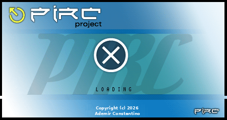
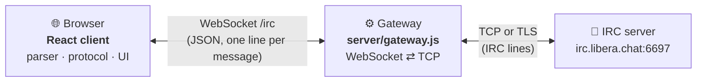

<div align="center">



# pIRC Web

**The classic pIRC client, rebuilt in 2026 to run in your browser.**

[pIRC](https://github.com/ademirconstantino/pirc), the IRC client created by
Ademir Constantino, in its TS/JS version port: React + TypeScript.

[](https://react.dev)
[](https://www.typescriptlang.org)
[](https://vitejs.dev)
[](https://nodejs.org)
[](https://www.gnu.org/licenses/old-licenses/gpl-2.0.html)

[Features](#-features) ·
[Quick start](#-quick-start) ·
[Usage](#-usage) ·
[How it works](#-how-it-works) ·
[Deployment](#-deployment) ·
[From Java to the web](#-from-java-to-the-web)

</div>

---

<p align="center">
  
</p>

## ✨ Features

- 🪟 **The original desktop feel.** Each channel, private chat and the server
  messages get their own window inside pIRC. Windows can be dragged, resized,
  minimized and maximized, and a taskbar lists them all.
- 🔌 **Familiar *Conexão* window.** Name, e-mail, nickname and alternative
  nickname, with servers grouped by network. You can add, edit and delete
  servers.
- 💬 **Channels done right.** Topic bar, a nicknames list sorted by status
  (`@` operators, `+` voice, users), and joins, parts, quits, kicks, modes and
  nickname changes as they happen.
- ✉️ **Private messages.** Double-click a nickname to open a private window.
  Incoming private messages open one automatically.
- ⌨️ **Slash commands.** `/join`, `/part`, `/nick`, `/msg`, `/me`, `/quit`, and
  anything else is sent to the server as typed. ↑ and ↓ bring back the lines
  you typed before.
- 🎨 **mIRC colors stripped**, as in the original. Text in UTF-8 and Latin-1
  displays correctly.
- 🔒 **SSL/TLS connections** (new in the web version), ready for Libera.Chat,
  OFTC and other modern networks.
- 🤖 **CTCP.** Answers `VERSION` and `PING`, and shows `ACTION` (`/me`).
- 🔔 **Unread highlighting.** The taskbar marks windows with new messages.
- 📱 **Works on phones.** On small screens each window fills the screen and the
  taskbar works as tabs.
- 🇧🇷 **Interface in Portuguese**, faithful to the original pIRC.

## 📸 Screenshots

| Connection | Mobile |
| :---: | :---: |
|  |  |

## 🚀 Quick start

You need **Node.js 18 or newer**.

```sh
git clone <this repository> pirc-web
cd pirc-web
npm install
npm run dev
```

Open **http://localhost:5173**. `npm run dev` starts the IRC gateway on port
`8667` and the Vite dev server together.

| Script | What it does |
| --- | --- |
| `npm run dev` | Gateway + Vite dev server with hot reload |
| `npm test` | Runs the unit tests (Vitest) |
| `npm run typecheck` | Checks the TypeScript types |
| `npm run build` | Builds the client into `dist/` |
| `npm start` | Production: the gateway serves `dist/` and the WebSocket on http://127.0.0.1:8667 |

## 💡 Usage

1. Open **Arquivo › Conectar**
2. Fill in the name, e-mail, nickname and alternative nickname
3. Pick the **Grupo** (network) and the **Servidor**, then click **Conectar**
4. In the **Main Window**, type `/join #channel`

Text typed in a channel or private window is sent as a message. Text starting
with `/` is sent as an IRC command:

| Command | Description |
| --- | --- |
| `/join #channel` | Joins a channel |
| `/part #channel` | Leaves the channel (closing its window does the same) |
| `/nick newnick` | Changes your nickname |
| `/msg nick text` | Sends a private message |
| `/me text` | Sends an action: `* nick text` |
| `/quit [message]` | Disconnects from the server |

Any other command (`/mode`, `/topic`, `/whois`, ...) is sent to the server
as typed.

> [!TIP]
> If your nickname is already in use when you connect, pIRC switches to
> your **alternative** nickname automatically.

### Servers list

The list keeps **brasirc.com.br** from pIRC's original `cfg/servers.xml` and
adds the IRC networks that are online today. TLS is used wherever the network
has a valid certificate:

| Network | Server | Port |
| --- | --- | --- |
| BrasIRC 🇧🇷 | `irc.brasirc.com.br` | 6667 · 6697 🔒 |
| PTnet 🇵🇹 | `irc.ptnet.org` | 6697 🔒 |
| Libera.Chat | `irc.libera.chat` | 6697 🔒 |
| OFTC | `irc.oftc.net` | 6697 🔒 |
| EFnet | `irc.efnet.org` | 6667 |
| IRCnet | `irc.underworld.no` | 6667 |
| Undernet | `irc.undernet.org` | 6667 |
| DALnet | `irc.dal.net` | 6697 🔒 |
| QuakeNet | `irc.quakenet.org` | 6667 |
| Rizon | `irc.rizon.net` | 6697 🔒 |
| EsperNet | `irc.esper.net` | 6697 🔒 |
| GameSurge | `irc.gamesurge.net` | 6667 |
| hackint | `irc.hackint.org` | 6697 🔒 |
| IRCHighway | `irc.irchighway.net` | 6667 |
| Snoonet | `irc.snoonet.org` | 6697 🔒 |
| SwiftIRC | `irc.swiftirc.net` | 6697 🔒 |
| Ergo | `irc.ergo.chat` | 6697 🔒 |

Your changes are saved in the browser's `localStorage`. To use TLS on a
server, tick **SSL/TLS** in the server editor (usually port `6697`).

## 🧠 How it works

Browsers can't open raw TCP connections, so pIRC Web has two small parts:



- **The client (`src/`)** does all the IRC work in the browser: parsing lines,
  handling the protocol, keeping windows and nicknames up to date.
- **The gateway (`server/gateway.js`)** only moves lines back and forth, like
  `IRCSocket.java` did. It sends UTF-8 and reads UTF-8, falling back to
  ISO-8859-1 for lines that aren't valid UTF-8. It also strips CR/LF from each
  line, so a message can't sneak in a second IRC command.

## 🌍 Deployment

Build the client and start the gateway. It serves the static files and the
WebSocket from the same port:

```sh
npm run build
PIRC_ALLOWED_ORIGINS=https://irc.example.com npm start
```

### Gateway settings

| Variable | Default | Description |
| --- | --- | --- |
| `PIRC_GATEWAY_PORT` | `8667` | Port to listen on |
| `PIRC_GATEWAY_HOST` | `127.0.0.1` | Address to listen on |
| `PIRC_ALLOWED_PORTS` | `6660-6699,7000` | IRC ports the gateway may connect to |
| `PIRC_ALLOWED_HOSTS` | *(any)* | Comma-separated IRC hosts allowed |
| `PIRC_ALLOWED_ORIGINS` | *(any)* | Comma-separated page origins allowed to use the WebSocket |
| `VITE_PIRC_GATEWAY` | same host, `/irc` | Build-time: WebSocket URL of a gateway on another address |

> [!WARNING]
> Out of the box, the gateway connects to **any host** on the allowed ports.
> On a public server, set `PIRC_ALLOWED_HOSTS` and `PIRC_ALLOWED_ORIGINS`.
> Otherwise anyone can use your gateway as an IRC relay.

### Behind nginx (HTTPS)

The client switches to `wss://` automatically when the page is served over
`https://`:

```nginx
server {
    listen 443 ssl;
    server_name irc.example.com;
    # ssl_certificate ... ;

    location / {
        proxy_pass http://127.0.0.1:8667;
        proxy_http_version 1.1;
        proxy_set_header Upgrade $http_upgrade;
        proxy_set_header Connection "upgrade";
        proxy_set_header Host $host;
        proxy_read_timeout 1d;   # keep idle IRC sessions open
    }
}
```

## ☕ From Java to the web

Every piece of the Swing client has a counterpart here:

| Java (pIRC) | Web (pIRC Web) | Role |
| --- | --- | --- |
| `IrcMessage.java` | `src/irc/IrcMessage.ts` | Parses IRC lines |
| `ColorStrip.java` | `src/irc/colorStrip.ts` | Removes mIRC colors and styles |
| `NickNameList.java` | `src/irc/nickList.ts` | Channel nicknames, sorted by status |
| `ProtocolHandlerConstants.java` | `src/irc/constants.ts` | Numeric replies |
| `PIRCFrame` + `ProtocolHandler` | `src/irc/IrcClient.ts` | Connection, commands, protocol |
| `Server` + `PIRCServersReader` | `src/servers.ts` | Servers list |
| `JDesktopPane` | `src/components/Desktop.tsx` | Window desktop |
| `ChatWindow`, `PIRCChannelWindow` | `src/components/ChatView.tsx` | Chat window and nicknames |
| `PIRCConnectionWindow` | `src/components/ConnectionDialog.tsx` | *Conexão* window |
| `PIRCEditServer` | `src/components/EditServerDialog.tsx` | Add or edit a server |
| `PIRCExceptionWindow` | `src/components/ErrorDialog.tsx` | Error dialog |
| `PIRCMenu` | `src/components/MenuBar.tsx` | *Arquivo* and *DCC* menus |
| `IRCSocket.java` | `server/gateway.js` | Connection to the IRC server |

The Java unit tests (`IrcMessageTest`, `NickNameListTest`, `ColorStripTest`)
were ported to Vitest. The protocol handling has its own tests in
`src/irc/IrcClient.test.ts`.

### What changed

- ➕ SSL/TLS connections, a window taskbar, unread highlighting, input history
  and a phone layout
- ✏️ Your own messages show as `<nick> text` (the Java client showed `> text`)
- ➖ No ident server on port 113, since browsers can't run one
- ➖ `PASS pIRC` is no longer sent when connecting, because some networks treat
  it as an account password
- ➖ The Dean S. Jones icons aren't included, because their license doesn't
  allow use on web pages

## 🗺️ Roadmap

Not implemented yet, same as the Java client:

- [ ] DCC (send and chat)
- [ ] *Opções* (options) dialog
- [ ] Themes from pIRC's `cfg/themes` (Dark, HighContrast, LightWave)
- [ ] Translations from `cfg/i18n` (English, Português)
- [ ] SASL and IRCv3 features

## 🙏 Credits

- **Ademir Constantino**: author of pIRC (2026)
- **João Pedrosa**: collaboration, including the mIRC color stripping (`ColorStrip`)

The original project page is at https://portableirc.sourceforge.io/.

## 📄 License

pIRC is free software, distributed under the terms of the **GNU General Public
License, version 2** or (at your option) any later version. The unofficial
Brazilian Portuguese translation is in
[`license/GPL-pt_BR.txt`](license/GPL-pt_BR.txt). The official English text is
at https://www.gnu.org/licenses/old-licenses/gpl-2.0.html.

<div align="center">

Copyright © 2026 Ademir Constantino

<sub>Made with ⚛️ in 2026.</sub>

</div>
